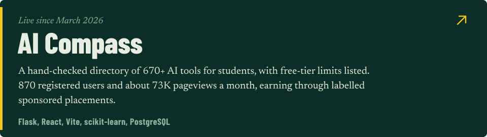
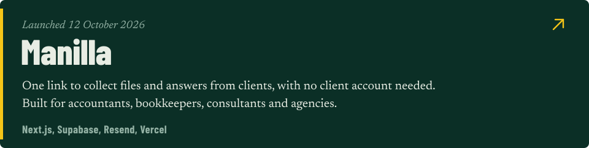
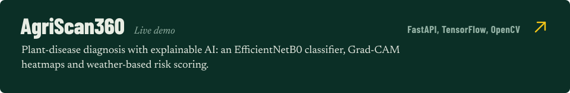
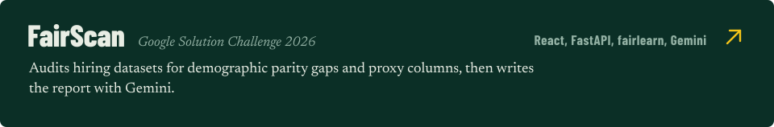
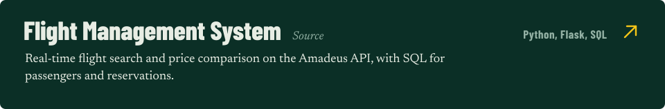
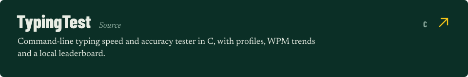

 

&nbsp;
&nbsp;
&nbsp;
&nbsp;

 

I start with small, everyday problems and build products around them, then take each one all the way to launch: the design, the code, search traffic and getting paid. Right now that means two live products, AI Compass and Manilla, alongside the core team at Ashwa Racing, where I look after sponsorships, alumni relations and the website.

I'm open to internships, contributing to projects and partnering on new products.

 

## Selected work

Case studies for [AI Compass](https://medhansh.vercel.app/work/ai-compass/) and [Manilla](https://medhansh.vercel.app/work/manilla/) are on my portfolio. Source for AgriScan360 is in [AgriScan360-Global](https://github.com/Singhmedhansh/AgriScan360-Global).

 

## Experience

<table>
  <tr>
    <td width="170"><b>Oct 2026 to now</b></td>
    <td><b>Founder, <a href="https://usemanilla.in">Manilla</a></b> Launched a no-login tool for collecting client files and answers, now working on early growth.</td>
  </tr>
  <tr>
    <td><b>Jul to Aug 2026</b></td>
    <td><b>MERN full-stack intern, Techvruk</b> (remote) Next.js 15, React 18 and TypeScript on the front end, Node and Express on PostgreSQL, Redis and S3 behind it. Built real-time features with Socket.IO, JWT and Google OAuth sign-in, and Gemini-powered features.</td>
  </tr>
  <tr>
    <td><b>Mar 2026 to now</b></td>
    <td><b>Founder, <a href="https://ai-compass.in">AI Compass</a></b> Took it from MVP to revenue: product, design, code, search traffic and sponsors.</td>
  </tr>
  <tr>
    <td><b>Nov 2025 to now</b></td>
    <td><b>SMP and IT core team, Ashwa Racing, RVCE</b> Joined as a member in November 2025 and moved to the core team in July 2026. Sponsorships, alumni relations, marketing, <a href="https://ashwaracing.org">ashwaracing.org</a>, and research on the team's planned driverless platform.</td>
  </tr>
</table>

 

## Stack

<table>
  <tr><td width="170"><b>Languages</b></td><td>Python, TypeScript, JavaScript, C, SQL, HTML, CSS</td></tr>
  <tr><td><b>Front end</b></td><td>React, Next.js, Redux Toolkit, Vite, Tailwind CSS</td></tr>
  <tr><td><b>Back end and data</b></td><td>Node.js, Express, Flask, FastAPI, PostgreSQL, Redis, Socket.IO</td></tr>
  <tr><td><b>Machine learning</b></td><td>TensorFlow, Keras, scikit-learn, OpenCV, fairlearn, Gemini API</td></tr>
  <tr><td><b>Cloud and tools</b></td><td>Vercel, Render, Cloudflare, Supabase, AWS S3, Git, Postman, Sentry, Resend</td></tr>
  <tr><td><b>Product</b></td><td>UI design, product strategy, launch and go-to-market, monetization, technical writing</td></tr>
</table>

 

## Education and certifications

- **B.E. in Computer Science and Engineering (AI & ML)**, RV College of Engineering, Bengaluru, 2025 to 2029
- **Google Solution Challenge 2026: Build with AI**, certificate of participation for the FairScan prototype
- **Crash Course on Python** (Google) and **Introduction to Artificial Intelligence** (IBM), both on Coursera
- **Mercedes-Benz USA** via Coastline ROP: Electrical-Networking, plus 100+ modules of Registered Technician eLearnings
- AWS Certified Solutions Architect, in preparation
