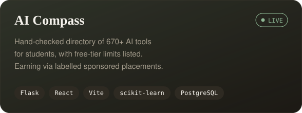
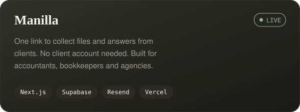
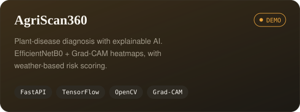
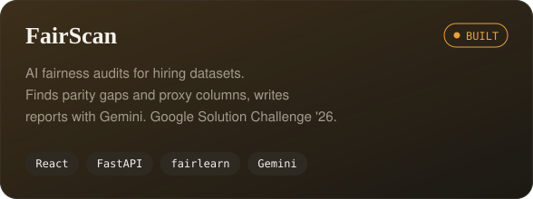
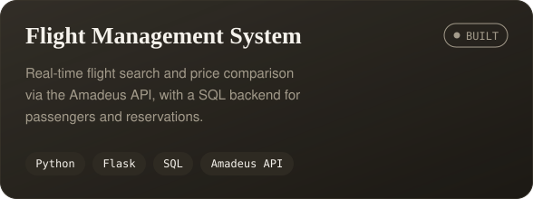
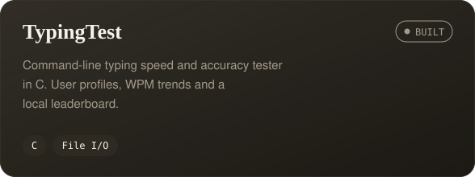
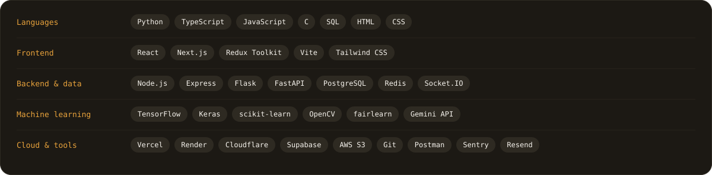

 

 

## 👋 About

Second-year CS (AI & ML) student at **RV College of Engineering, Bengaluru**. I start from small, everyday problems and turn them into products people actually use. I run two of them end to end, from first commit to monetization: **AI Compass** and **Manilla**.

I learn by building, and I care about the whole thing: the design, the code, the launch and the numbers afterwards. Outside class I follow automobiles and sports, and I'm on the core team at **Ashwa Racing, RVCE**.

> 🟢 **Open to** internships, contributing to projects, and partnering on new products. Say hi.

 

## 📈 AI Compass, by the numbers

  

Live since March 2026 at [ai-compass.in](https://ai-compass.in). Earning revenue from labelled sponsored placements since October 2026.

 

## 🚀 Selected work

<table>
  <tr>
    <td width="50%"></td>
    <td width="50%"></td>
  </tr>
  <tr>
    <td width="50%"></td>
    <td width="50%"></td>
  </tr>
  <tr>
    <td width="50%"></td>
    <td width="50%"></td>
  </tr>
</table>

  Case studies: <a href="https://medhansh.vercel.app/work/ai-compass/">AI Compass</a> · <a href="https://medhansh.vercel.app/work/manilla/">Manilla</a> · Live demo: <a href="https://medhanshcoder-agriscan360.hf.space">AgriScan360</a>

 

## 🧰 Stack

  

Product side: UI design, product strategy, launch and go-to-market, monetization, technical writing.

 

## 🛠️ Experience

| When | Role | What I did |
| :-- | :-- | :-- |
| **Oct 2026 – now** | Founder & Maker, [Manilla](https://usemanilla.in) | Launched a no-login client file and answer collection tool, now working on early growth |
| **Jul 2026 – now** | SMP & IT Core Team, Ashwa Racing, RVCE | Sponsorships and alumni relations, marketing, maintaining [ashwaracing.org](https://ashwaracing.org), research on the team's planned driverless platform |
| **Jul – Aug 2026** | MERN Full-Stack Intern, Techvruk (remote) | Next.js 15, React 18, TypeScript and Node/Express on PostgreSQL, Redis and S3. Socket.IO real-time features, JWT and Google OAuth, Gemini-powered features |
| **Mar 2026 – now** | Founder & Maker, [AI Compass](https://ai-compass.in) | Ran it from MVP to monetization: product, design, code, SEO and sponsors |
| **Nov 2025 – Jul 2026** | Team Member, Ashwa Racing, RVCE | Joined the team, moved to the core team in July 2026 |

 

## 🏅 Certifications & milestones

- **Google Solution Challenge 2026: Build with AI**, participation certificate for the FairScan prototype (Google Developer Groups × Hack2Skill)
- **Crash Course on Python**, Google (Coursera) · **Introduction to Artificial Intelligence**, IBM (Coursera)
- **Mercedes-Benz USA** via Coastline ROP: Electrical-Networking, and 100+ modules of Registered Technician eLearnings
- ☁️ **AWS Certified Solutions Architect**: in preparation

 

## 📊 Activity

  <picture>
    <source media="(prefers-color-scheme: dark)" srcset="https://raw.githubusercontent.com/Singhmedhansh/Singhmedhansh/output/github-contribution-grid-snake-dark.svg">
    <source media="(prefers-color-scheme: light)" srcset="https://raw.githubusercontent.com/Singhmedhansh/Singhmedhansh/output/github-contribution-grid-snake.svg">
    
  </picture>

 

*Building in public from Bengaluru.* ☕

